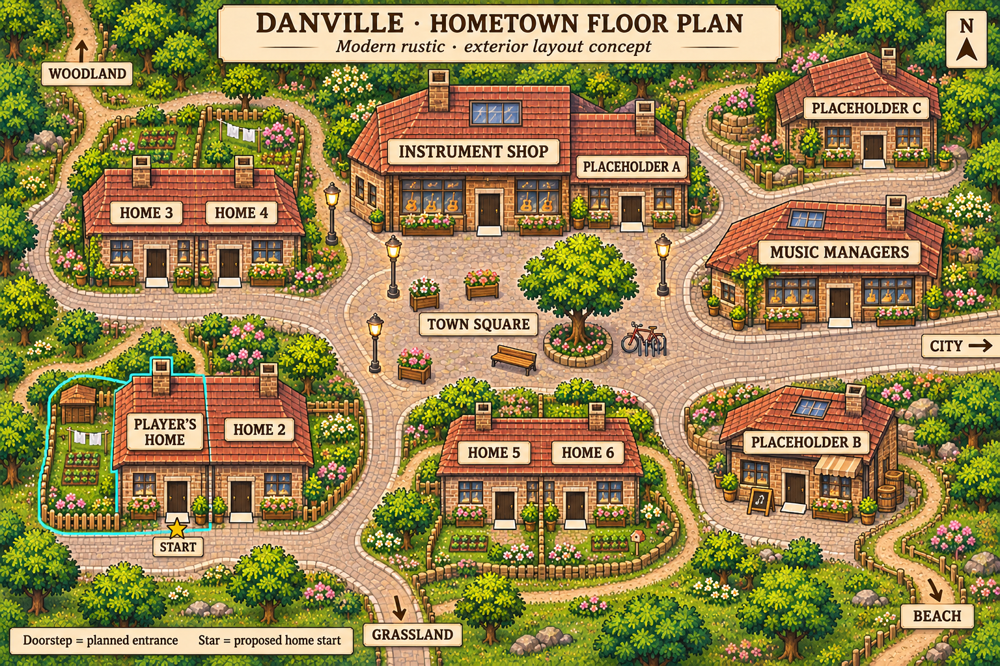

# Hometown floor plan

Design reference for the player's hometown: the same settlement represented by **Town** on the world map. Its exterior is now a playable Town level, accessible through that map button. The current playable opening remains the Level 1 tent. Building interiors remain future work.

## Character and layout

A small contemporary town with rustic brick and timber buildings, terracotta roofs, renovated shopfronts, street lighting, bicycle parking and planted gardens. Modern details should keep it recognisably present-day. An irregular pedestrian square acts as the main landmark, with staggered buildings and connected winding lanes rather than a symmetrical grid. A broad shopping route narrows into quieter residential lanes and small gravel garden paths. Widths vary while retaining comfortable player clearance.

The residential area contains three pairs of semi-detached homes. Each pair shares a party wall and joined roof, but each dwelling has its own accessible front door and private garden boundary. The player's home sits on the quieter southwestern lane, away from the main eastern shopping route.

| Building | Location | Intended role |
| --- | --- | --- |
| Player's home and Home 2 | Southwest residential lane | Semi-detached pair. The player's home is the left half, with a private fenced garden and its own entrance; only this half and garden are highlighted. The star proposes a future town start at the player's front door. |
| Instrument shop | North side of the square | Enterable music shop facing the square. |
| Music managers | East side of the square | Enterable shop/office for music managers, in a converted brick building. Specific services remain to be designed. |
| Home 3 and Home 4 | Northwestern residential lane | Second semi-detached pair, with independent entrances and gardens. |
| Home 5 and Home 6 | Southern residential pocket | Third semi-detached pair, reached from the quieter lanes and gravel paths. |
| Placeholder A | Adjoining the instrument shop, north of the square | Flexible enterable premises with a separate door; purpose to be decided. |
| Placeholder B | Southeast of the square | Flexible enterable premises; purpose to be decided. |
| Placeholder C | Northeast of the square | Flexible enterable premises; purpose to be decided. |

The square provides seating, an off-centre tree and room for possible future busking. These are layout ideas, not committed gameplay mechanics. Cream doorsteps mark planned building entrances. Keep every doorstep connected to the public lanes and leave enough clearance for the player around walls, trees and street furniture. In the playable layout, garden fences must have explicit gates or gaps on routes to front doors, particularly for Homes 5 and 6: the illustration's fence lines are not collision instructions.

## Connections and future implementation

Connections lead northwest to Woodland, east to City, south to Grassland and southeast to Beach, following their relative positions on the world map. The southern route now returns to the playable Grassland field. The other three routes mark future connections.

Building interiors are outside this exterior increment. The playable background at `public/assets/maps/town.png` removes the planning annotations and opens garden gates. Building identities, footprints, door approaches, walkable polygons, obstacles and exits live in `public/assets/maps/town.json`. Placeholder names and collision geometry can be adjusted there; visible building shapes require editing the matching artwork. The editable `public/assets/maps/town-collision.png` supplies collision ground, sampled on a two-pixel grid with three-pixel foot clearance. Press E in Town to paint corrections; see [collision-painting.md](collision-painting.md). The JSON polygons remain a fallback. Open garden gates and stepping stones are usable; beds, fences and street furniture remain solid. The image itself is not a collision mask.

The current revision was edited with built-in Image Gen from the [original concept](town-floorplan.png). Its full edit prompt is saved in [town-floorplan-v2-prompt.txt](town-floorplan-v2-prompt.txt); the original generation prompt remains in [town-floorplan-prompt.txt](town-floorplan-prompt.txt).
